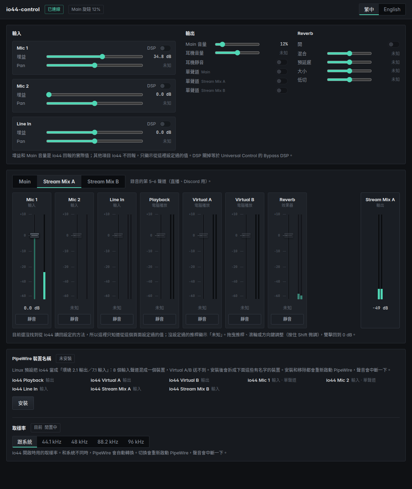

# io44-control

Control a PreSonus Revelator io44 without Universal Control, Linux first (Windows too). PreSonus ships Universal
Control for Windows and macOS only; on Linux the io44 plays and records as a standard USB audio device, but its mixer,
processing and phantom power can't be changed. This project talks to the io44's own control interface directly.

The settings and the processing are io44-control's own. Universal Control was only looked at to learn the protocol
(what each message and field means); nothing is taken from it: not its files, not its presets, not its ways of
turning knobs into filters. The processing is stream-mic's design (a sister project), run by the io44's DSP.

## How it talks to the io44

- USB interface 5 (vendor class), alternate setting 1, bulk endpoints 0x01 (out) and 0x81 (in). The audio interfaces
  stay with the kernel's snd-usb-audio, so sound keeps working while the controller runs.
- Messages are 4-character codes (stored reversed) with a sequence number: `GetP` reads (the meters, `JaSt`),
  `SetP` writes (`mprm` a bus's mix matrix, `Para`/`Pari` parameters, `Bqdf`/`MBdf` biquad coefficients, `cpxt`
  compressor, `gate`, `lim `, `vrvb` reverb, the voice effects). See `io44/proto.py`, and `io44/settings.py` for
  what each field means.
- The io44 runs fixed processing parts with the numbers it is given: the computer works out the mix gains and the
  filter coefficients, and keeps the settings, since the device does not report them.

## Use

Give your user access to the device once (copies the rule, members of `plugdev` may then open it):

    sudo cp udev/70-revelator-io44.rules /etc/udev/rules.d/
    sudo udevadm control --reload
    # then unplug and plug the io44 back in

Then, from this folder (Python 3's standard library only, no packages to install; libusb-1.0 from the system):

    python3 -m io44 ui                         # the control page in the browser (http://127.0.0.1:8794/)

Or from the command line:

    python3 -m io44 status                     # gains, Main volume and the blend as the io44 reports them
    python3 -m io44 gain mic1 30               # input gain in dB (Mic 1 0..60, Headset 0..30, Line In -12..+12)
    python3 -m io44 dsp mic1 off               # the mic's processing bypassed
    python3 -m io44 record mic1 dry            # the computer and the stream mixes get Mic 1 before its processing
    python3 -m io44 pan headset -0.5           # -1 left .. 1 right
    python3 -m io44 main-volume 20             # % (the front knob); phones-volume, phones mute|unmute
    python3 -m io44 mono stream-a on
    python3 -m io44 reverb mix=0.8 predelay=50 size=0.65 hp=175

    python3 -m io44 meters 5                   # the meters by name, for 5 seconds
    python3 -m io44 mix stream-a mic1 -6       # Mic 1 at -6 dB in Stream Mix A
    python3 -m io44 mix stream-b playback -145 # Playback off in Stream Mix B
    python3 -m io44 mix                        # every mix as kept here
    python3 -m io44 apply                      # write everything to the io44 again

Buses: `main`, `stream-a`, `stream-b`. Sources: `playback`, `virtual-a`, `virtual-b`, `mic1`, `headset`, `fx` (the
reverb's return), `line`. Gains in dB, -145 is off.

The io44's reverb, measured through the loopback (2026-11-09, a sweep, the response worked out from it): the wet
starts 24 ms after the dry by itself (the pre-delay adds to that), sparse for its first 20 ms (echo density 0.45,
then 0.8, then 0.9), decorrelated left and right; `size` sets the decay steeply (at 1 kHz: 0 0.66 s, 0.25 0.9 s,
0.5 1.3 s, 0.75 2.1 s, 1 7 s) and the highs die sooner the bigger it is (4 kHz/1 kHz 0.75 at size 0, 0.3 at 1). Its
algorithm is the io44's own; only these settings can be chosen.

So the page offers styles instead, after TC-Helicon VoiceTone R1's (its manual describes each by length, tone,
initial reflections and pre-delay; vocal ranges from mixing guides): Ambience, Room, Studio, Club, Plate, Hall,
Theatre, Arena, each a size, a pre-delay and a low cut (`io44/settings.py`, REVERB_STYLES), and one Dry/Wet amount:
how much of the mics goes to the reverb, the style's own level at its middle, nothing at 0. The reverb's own settings
stay under Advanced (changing one makes it "custom"). What the io44 cannot do: its early reflections and its dark
tail are its own, and nothing decays shorter than 0.66 s. The amount's middle levels are worked out from the measured
responses and one recording: they are to be checked by ear.

    python3 -m io44 reverb style plate
    python3 -m io44 reverb amount 0.5

The reverb's `mix` is its wet/dry: 1 returns only the reverb, 0 returns the dry send (not silence). It has no on/off
(its on word changes nothing, recorded 2026-11-09): it is turned down with each input's reverb send and the `fx`
source in each mix.

### The settings

The io44 does not report its settings (only the gains, the Main knob, the monitor blend and the meters), so they are
kept on the computer (`~/.config/io44-control/state.json`, Windows `%APPDATA%\io44-control`) and written whenever the
io44 is there. The first time they start neutral: every input into every mix at 0 dB (Main through the blend),
playback and the virtual outputs in Main only, nothing sent to the reverb, no processing; the gains and the blend
as the io44 has them. A file from an older version (it held Universal Control's settings) is moved aside to
`state.v1.json`; only the DSP bypass and the headphones are kept from it. 48V is never written.

### Processing

Mic 1 and the headset each have stream-mic's chain, with its ranges: Low Cut (40-400 Hz, 12 dB/oct), EQ (Low: shelf
at 200 Hz, Presence: bell at 3 kHz, Air: shelf at 10 kHz, +-6 dB), Gate (threshold, range, attack, hold, release,
expander), Compressor (threshold, ratio, knee, attack, release, makeup) and Limiter (ceiling, release). The page
draws the EQ's response with points to drag; a change sends that part only.

    python3 -m io44 fat mic1 eq on 1           # mic1 | headset; PART lowcut | eq | gate | comp | limit | voicefx
    python3 -m io44 fat mic1 eq pres 2
    python3 -m io44 fat mic1 comp threshold -24
    python3 -m io44 fat mic1 voicefx model 1   # Mic 1 only: 0 Doubler, 1 Detune, 2 Robot A, 3 Robot B, 4 Robot C, 5 Echo
    python3 -m io44 fat mic1 voicefx on 1

The voice effects are the io44's own (its firmware runs them; the computer sends their settings): one at a time, on
Mic 1. Some need filters from the computer (Doubler's low boost, Detune's low-pass, Robot A's ten-channel filter
bank); those are ours. Choosing an effect makes the io44 set it up for about a second and drop what comes meanwhile,
so its settings are sent again a second later.

The times are time constants, as in stream-mic. The io44 reads its time fields its own way, so they are converted
with factors measured with Main Out L wired into Input 1 (compressor attack and release, the limiter's release, the
gate's coefficients; see `io44/settings.py`); through the page's conversion, attack 10 ms measured 10.3 ms, release
120 ms 131-136 ms, the limiter's 50 ms 32-53 ms after its fixed 25 ms pause, the gate's 200 ms about 230 ms. The
gate needs a hold of at least 1 ms: with none it never opens.

Checked on 2026-11-09 by recording a speaker into a condenser mic on Mic 1: the compressor's curve (threshold -30,
ratio 8: 8.0, 4.6, 1.0 dB of reduction where 8.0, 4.5, 1.0 were expected), the limiter (peaks held 3 dB under the
ceiling, the routing's own 3 dB), the gate, each EQ band, and all six voice effects.

### Monitor blend

The front panel's blend (how much of the inputs and of the computer's playback Main gets) is kept by the io44 but not
applied by it: the computer writes Main again when it moves. io44-control's server looks at it four times a second
and follows it; the page has it under Outputs too (-1 inputs only, 0 both at 0 dB, +1 playback only). The reverb's
return in Main follows the inputs' side, the stream mixes keep it whatever the blend.
**With speakers keep it toward playback**: in the middle the mics reach the speakers at 0 dB.

While the page's server runs it looks for the io44 every 2 s and writes everything each time it is there again
(plugged in, or back after being unplugged or powered off: it starts on its own defaults then). To have that from
login, without opening the page:

    python3 -m io44 service install            # a user service (systemd --user) running the page's server
    python3 -m io44 service uninstall

While it runs the command line cannot open the io44 (one program at a time): use the page, or stop the service.

If every mix goes silent while the meters of the inputs and playback still move, the reverb's filter may hold a NaN
(Universal Control's service has sent one when restarted). `POST /api/repair` (the tray's "修復混音靜音") changes
the sample rate away and back, which starts the io44's DSP over, and writes everything again.

### On Windows

    py\pythonw.exe -m io44 tray             # in the notification area, next to the clock

The same server and page, from the notification area: right-click for the page, writing the settings now, starting
with Windows (a shortcut in your Startup folder), and stopping or bringing back Universal Control's service. Only one
program can hold the io44's control interface: io44-control takes it once Universal Control's service is stopped
(the menu stops it and sets it to Disabled, with an administrator prompt). The tray's log is beside the settings.

The control interface has Microsoft's WinUSB driver, so the code is the Linux one with `libusb-1.0.dll` beside the
`io44` folder. The sample rate is set through the io44's USB audio driver (`PaeDSPUSBapi_x64.dll`, installed with
Universal Control); everything is written again after a change. Windows 11 puts a new tray icon under the ^ at first:
drag it onto the taskbar to keep it in sight.

### Sample rate

    python3 -m io44 rate 96000     # or 44100, 48000, 88200; auto = the system's rate; no argument: what is set

A WirePlumber rule (`~/.config/wireplumber/wireplumber.conf.d/io44-control-rate.conf`) opens the io44 at that rate;
PipeWire converts when the rest of the system runs at another. Changing it restarts PipeWire.

### Named channels in PipeWire

Out of the box PipeWire shows the io44 as "Analog Surround 2.1" output and "Analog Surround 7.1" input: Mic 1, the headset,
Line In and both stream mixes arrive as one 8-channel input, and Virtual A and B cannot be played to at all.

    python3 -m io44 pipewire install     # or: print (show the configuration), uninstall

puts the card on its Pro Audio profile and adds named devices on top of it: outputs *io44 Playback*, *io44 Virtual
A*, *io44 Virtual B*; inputs *io44 Mic 1*, *io44 Headset* (mono), *io44 Line In*, *io44 Stream Mix A*, *io44 Stream
Mix B*. It restarts PipeWire (sound stops for a moment) and makes *io44 Playback* the default output. The file goes
to `~/.config/pipewire/pipewire.conf.d/io44-control.conf`; `uninstall` removes it and puts the default profile back.

## What is known

Checked on the device from Linux:

| | |
| --- | --- |
| Buses | 0 Main, 1 Stream Mix A (capture channels 5-6), 2 Stream Mix B (7-8) |
| Sources | 0 Playback, 1 Virtual A, 2 Virtual B, 3 Mic 1, 4 Headset (input 2, the headset jack's mic), 5 FX return, 6 Line In |
| Playback channels | 1-2 Playback, 3-4 Virtual A, 5-6 Virtual B |
| Capture channels | 1 Mic 1, 2 Headset, 3-4 Line In, 5-6 Stream Mix A, 7-8 Stream Mix B |
| Meters (`JaSt`, floats from byte 28) | 0-5 the playback channels, 6 Mic 1, 14-15 Main, 16-17 Stream Mix A, 18-19 Stream Mix B, 46 the Main knob (0..1); 7-13 read as Mic 1 after processing, the headset, FX return and Line In but not yet confirmed; 20-37 sit at 1.0 (gain reduction?) |

Messages for one input carry its number at byte 28 of the chunk (0 Mic 1, 1 Headset, 2 Line In). On `Appl`: Para 1
headphone volume (0..1), 2 Main volume (0..1, the knob), 3 input gain (dB), 4 the input's DSP amount (0 = bypassed);
Pari 6 headphones mute. On target 0 (per input): Para 1 the send to the reverb (dB, -145 off), 2 pan (0..1). On a bus (target 100):
Pari 8 mono. Reverb: `vrvb` on target 202 (on, mix, 1, pre-delay s, size, high-pass Hz). The meter reply carries the
gains (slots 48-50), Main's volume (46) and the blend (47); the rest is not reported. The processing's messages:
`io44/settings.py`.

## Layout

- `io44/` the controller: `web.py` and `ui/` (the page, in stream-mic's style), `usb.py` (libusb through ctypes), `proto.py` (the messages), `device.py` (buses, sources,
  meters by name), `settings.py` (the settings and the messages they make), `pwconf.py` (the PipeWire configuration), `__main__.py` (the command line).
- `tools/` how the protocol was found, on Windows with Universal Control installed: `ucctl.py` talks to
  Universal Control's background service (UCNet, TCP 49670) to change one parameter at a time, `sweep.py` does that
  for every parameter while USBPcap records, `sweep_match.py` and `usbparse.py` match each change to the USB message
  it caused.
  The recordings they made are not included: they are one person's device.

## Safety

- Never switch on 48 V phantom power with a ribbon or tube mic connected, or anything that should not get it.
- Mix and parameter writes change what you hear immediately; keep the monitor volume low while trying things.

## License

io44-control is free software: you can redistribute it and/or modify it under the terms of the GNU General Public
License as published by the Free Software Foundation, either version 3 of the License, or (at your option) any later
version. See `LICENSE`.

The fonts in `io44/ui/fonts/` are under the SIL Open Font License (`OFL-*.txt` next to them). The Windows package
also carries libusb (LGPL-2.1) and the Python embeddable distribution (PSF License), unmodified, with their licenses.

PreSonus, Revelator and Universal Control are trademarks of their owners. This project is not affiliated with or
endorsed by PreSonus.
